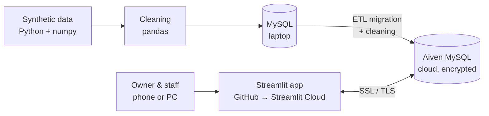
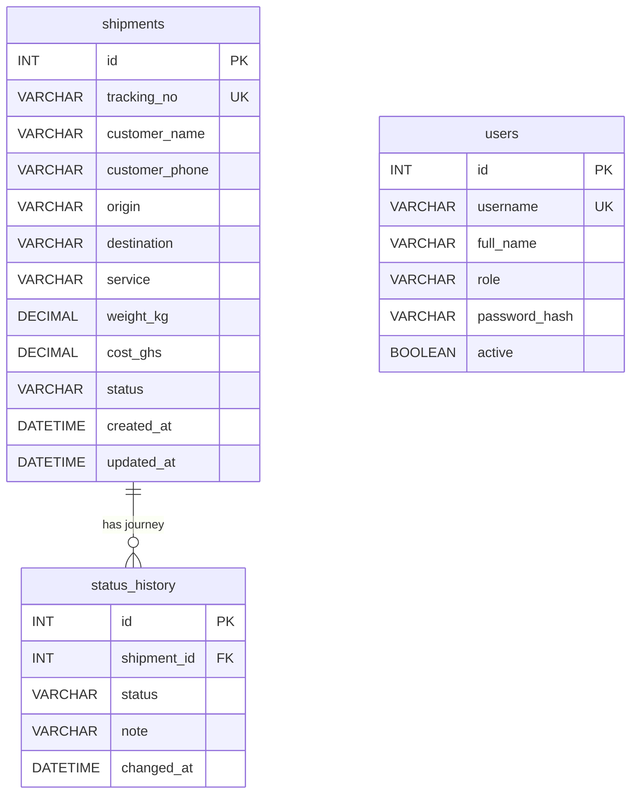

# 🚚 PKO Shipping: Shipment Tracker

**A full-stack data app for a Ghanaian logistics company: from raw, messy data to a secure, cloud-hosted tracking system.**

🔗 **Live app:** [pko-shipping.streamlit.app](https://pko-shipping.streamlit.app) *(staff login required; demo access available on request)*

Built with **Python · pandas · MySQL · SQLAlchemy · Streamlit · Plotly**, deployed on **Streamlit Community Cloud** with an **Aiven MySQL** database.

> All data shown in this project is **synthetic** (generated for development and demonstration). No real customer data is stored in this repository.

---

## 📌 The problem

PKO Shipping is a small logistics company in Ghana. Like many small businesses, it needed a simple way to:

- **book** shipments and give customers a tracking number,
- **update** each parcel's status as it moves (Booked → Picked Up → In Transit → Out for Delivery → Delivered),
- let staff **track** any parcel and see its full journey,
- give the owner a **dashboard** of revenue, volumes and busiest routes,
- **export** records to Excel for reporting.

Spreadsheets and paper records make this slow, error-prone and hard to analyse. This app replaces them with one system that staff and the owner can open from any phone or computer.

---

## ✨ Features

| Page | What it does | Who can see it |
|---|---|---|
| 📊 **Dashboard** | KPI cards (total, active, delivered, revenue in GH₵) and four interactive charts: revenue by service, status breakdown, bookings per month, top routes | Admin |
| 📦 **New Shipment** | Booking form with input cleaning and validation; prices calculated automatically; generates a unique tracking number (e.g. `PKO26000501`) | Admin, Staff |
| 🔄 **Update Status** | Moves a parcel to its **next** step only, with notes (e.g. driver, location); cancellation allowed only before transit | Admin, Staff |
| 🔎 **Track Shipment** | Look up any tracking number to see a progress bar and the full journey timeline | Admin, Staff |
| 📋 **All Shipments** | Filter by status, service and date; search by name, phone or tracking number; **download to Excel** | Admin |
| 🔐 **Login** | Username/password login with **hashed passwords** and **role-based access** | Everyone |

The interface uses PKO's brand colours (red, white and black) and logo.

---

## 🏗️ Architecture



**Data pipeline:**

1. **Generate:** 500 realistic shipments (Ghanaian names, 7 cities, 3 service levels, realistic weight distribution) with deliberately injected errors.
2. **Clean:** a pandas pipeline that fixes each problem and verifies the fix.
3. **Load:** into MySQL with constraints that block bad data at the database level.
4. **Serve:** a Streamlit app that reads and writes through parameterised SQL.
5. **Migrate:** an ETL step (Extract → Transform → Load) moves the data to a cloud database over an encrypted connection.

---

## 🧹 Data cleaning

The raw data intentionally contained the kinds of errors real staff make:

| Problem | Example | Fix |
|---|---|---|
| Duplicate records | Same shipment entered twice | `drop_duplicates()`; tracking numbers verified unique |
| Inconsistent city names | `accra`, `ACCRA`, ` Accra `, `Acra` | Trim + title case + a mapping table for misspellings |
| Inconsistent labels | `delivered`, `DELIVERED` | Lowercase → map to an official list |
| Phone formats | `+233244…`, `024 412 3456` | Normalised to 10 digits starting with `0` |
| Weights with units / impossible values | `3.9kg`, `0`, `-2.5` | Strip units; **recover true weight from the pricing rule**: `weight = (cost − 20) ÷ rate` |
| Mixed date formats | `2026-01-31 16:22` and `31/01/2026 16:22` | Parse each known format explicitly; no guessing |
| Missing values | Names, phone numbers | Names → `Unknown`; phones left blank (never invented) |

Every step ends with an automated check (`True`/`False`) so the cleaning is **repeatable and verifiable**.

---

## 🗄️ Data model



**Database rules (constraints)** protect data quality even if the app has a bug:

- `UNIQUE` tracking numbers and usernames
- `CHECK (weight_kg > 0)`, `CHECK (cost_ghs >= 0)`
- `CHECK (service IN ('Express', 'Standard', 'Economy'))`
- `CHECK (origin <> destination)`
- `CHECK (role IN ('admin', 'staff'))`
- `FOREIGN KEY` linking every history row to a real shipment
- Money stored as `DECIMAL`, not floating point, to avoid rounding errors

---

## 🔒 Security & data protection

The app handles personal data (customer names and phone numbers), so security was built in from the start:

- **Hashed passwords:** PBKDF2-SHA256 with a random salt and 200,000 iterations. Real passwords are never stored.
- **Generic login errors:** "Wrong username or password" never reveals which one was wrong.
- **Role-based access (least privilege):** staff can book, update and track; only the admin sees revenue and can export data.
- **SQL injection protection:** every query uses bound `:parameters`; user input is never pasted into SQL text.
- **Transactions:** a shipment and its first history row are saved together or not at all.
- **Concurrency guard:** status updates use `WHERE status = :current`, so two staff can't update the same parcel at the same moment.
- **Encrypted database connection:** SSL/TLS with certificate verification (`ca.pem`).
- **Secrets kept out of code:** database credentials live in Streamlit's secrets manager, never in this repository.
- **Soft deactivation:** users can be switched off (`active = FALSE`) without deleting their history.

---

## 💡 What I learned (real problems I solved)

- **Validating dates against business reality.** A typo in the generator's start date produced 360 bookings *in the future*. The code ran without errors, but the data made no business sense. I traced the problem through the pipeline and added an automated **"no future dates"** check to the cleaning step.
- **Different databases, different rules.** Some uncleaned values (`'express '`, lowercase with a trailing space) passed my local MariaDB constraints, which compare text loosely, but were **rejected by MySQL 8 in the cloud**. I fixed this by adding a Transform step to the migration (ETL), and learned to test against the production database before going live.
- **Business logic as a cleaning tool.** Instead of deleting rows with impossible weights, I recovered the true weight from the company's pricing formula.
- **Caching and configuration.** Streamlit's `@st.cache_resource` keeps one database connection alive, which is fast, but it means credential changes need an app restart.

---

## 🧰 Skills demonstrated

| Area | Skills |
|---|---|
| **Data engineering** | Synthetic data generation, data cleaning, ETL, database migration, data validation |
| **SQL** | Schema design, constraints, `JOIN`, `GROUP BY`, aggregates, date functions, dynamic filtering, transactions |
| **Python** | pandas, numpy, SQLAlchemy, PyMySQL |
| **Analytics & BI** | KPI design, dashboards, interactive charts (Plotly), Excel export |
| **App development** | Streamlit forms, session state, multi-page navigation, custom theming and CSS |
| **Security & governance** | Password hashing, role-based access, SQL injection prevention, encryption in transit, handling personal data |
| **Deployment** | Git/GitHub, Streamlit Community Cloud, managed cloud database (Aiven), secrets management |
| **Business analysis** | Turning a small business's workflow into business rules, requirements and a working product |

---

## 📁 Repository structure

```
pko-shipping/
├── app.py                 # The Streamlit application (all pages)
├── requirements.txt       # Python packages
├── logo.png               # PKO Shipping logo
├── ca.pem                 # Public CA certificate for the encrypted DB connection
└── .streamlit/
    └── config.toml        # Brand theme (red, white, black)
```

Secrets (`.streamlit/secrets.toml`) are **not** included and must never be committed.

---

## ▶️ Run it locally

```bash
git clone https://github.com/Agnesagyeiwaaoppong/pko-shipping.git
cd pko-shipping
pip install -r requirements.txt
```

Create `.streamlit/secrets.toml` with your own MySQL details:

```toml
[mysql]
user = "your_user"
password = "your_password"
host = "your_host"
port = 3306
database = "pko_shipping"
# ssl_ca = "ca.pem"   # add this line for a cloud database that requires SSL
```

Then:

```bash
streamlit run app.py
```

The database needs the `shipments`, `status_history` and `users` tables (see **Data model**).

---

## 🗺️ Roadmap

- [ ] Record **which staff member** made each status update
- [ ] SMS or WhatsApp notifications to customers when a parcel is out for delivery
- [ ] Public tracking page for customers (tracking number only, no login)
- [ ] Admin page to add, deactivate and reset staff accounts
- [ ] Scheduled automatic backups
- [ ] Delivery-time analysis by route and service (SLA monitoring)

---

## 👩🏾‍💻 Author

**Agnes Agyeiwaa Oppong**
MSc Business Analytics, University of Ghana Business School

- GitHub: [@Agnesagyeiwaaoppong](https://github.com/Agnesagyeiwaaoppong)

*Built for PKO Shipping, Ghana. Another day, another package 📦*
